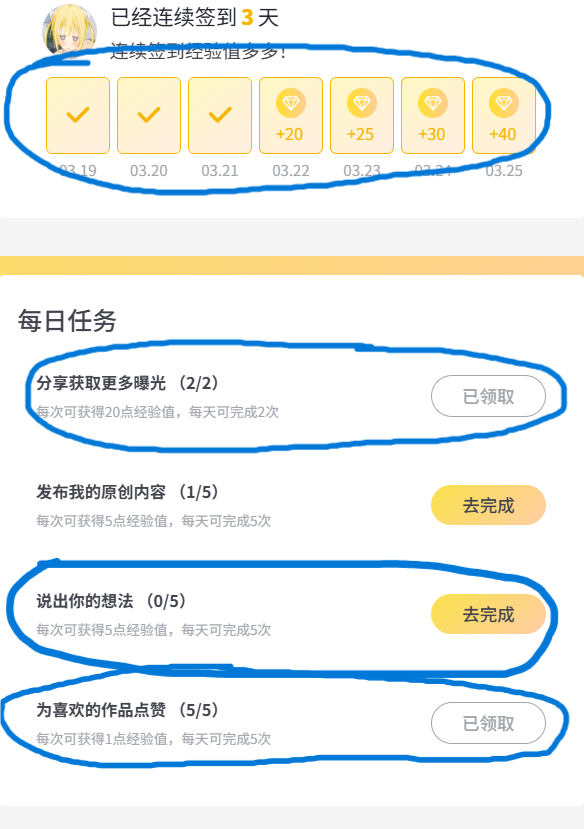
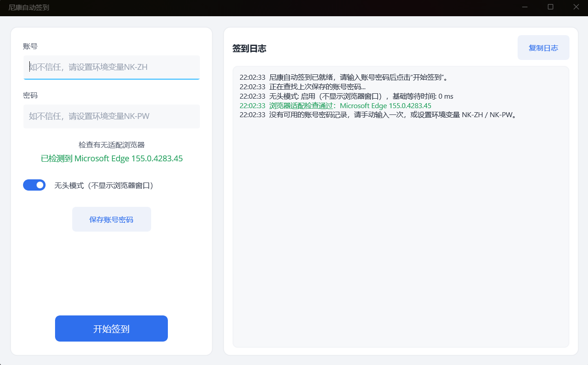

# my.nikon.com.cn 网站自动签到 — .NET 10 桌面版

## 项目概述

用 **Microsoft Playwright** 驱动本机 Chrome / Edge，自动完成「我的尼康」日常任务：

- **每日签到** — 自动完成连续签到
- **为作品点赞** — 为喜欢的作品点赞获取积分
- **分享获取曝光** — 因网站原因此功能无法使用，未开启
- **发表评论** — 自动发表 5 条评论

> **技术栈**: .NET 10 · .NET MAUI (WinUI 3) · Microsoft Playwright

## 快速开始

1. 解压发布包，双击 `NikonCheckIn.Gui.exe`
2. 左侧填「账号」「密码」
3. 点「开始签到」，右侧看日志

| 左侧控件 | 作用 |
|---|---|
| 账号 / 密码 | 登录用的手机号与密码 |
| 检查有无适配浏览器 | 打开程序时自动检查：绿色=已找到 Chrome/Edge，红色=未找到（可点链接下载 Edge） |
| 无头模式 | 打开=不显示浏览器窗口；关闭=能看到浏览器操作过程，便于排查 |
| 保存账号密码 | 点它才记住，下次打开自动填充；留空点它则等于清空记录 |
| 开始签到 | 依次执行 签到 → 点赞 → 评论 |

> 右侧日志可用鼠标选中复制，也可点「复制日志」一次性复制全部内容（手机号自动打码）。

### 账号密码的四种填法

| 方式 | 说明 |
|---|---|
| 界面输入 | 临时使用，不保存 |
| 「保存账号密码」 | 存到 `%LOCALAPPDATA%\NikonCheckIn\登录信息.txt`（**明文**），删掉该文件即清除 |
| 环境变量 `NK-ZH` / `NK-PW` | 输入框留空时在点「开始签到」那一刻读取，不显示、不落盘 |
| `账号密码配置.txt` | 放在 exe 同目录，启动时预填；也是修改「基础等待时间」的唯一入口 |

## 常见问题

> 卡在 `已点击确认按钮` 通常是密码错误
> 卡在登录之后的某几步通常是网络问题：在 `账号密码配置.txt` 里加大 `基础等待时间`（单位毫秒，例如 2000）
> 浏览器检查显示红色：安装 Google Chrome 或 Microsoft Edge 后重开程序
> 关闭无头模式时浏览器窗口出现在屏幕左上角，属于 Playwright 特性，正常现象

## 运行环境

| 依赖 | 版本要求 |
|------|---------|
| **OS** | Windows 10 1809+（推荐 Windows 11） |
| **浏览器** | Google Chrome 或 Microsoft Edge（自动检测） |
| **运行时** | 发布包已自带 .NET 与 Windows App SDK，无需另外安装 |

> 项目会自动检测本地的 Chrome / Edge 浏览器，无需手动配置驱动路径。

## 注意事项

1. **预先设置**：访问 https://my.nikon.com.cn/user/setting → 接受弹窗信息 → 全部关闭
2. **登录及安全性**：账号密码只保存在本机，源码不会收集任何用户数据
3. **密码存储**：用「保存账号密码」时密码以明文存放在 `%LOCALAPPDATA%\NikonCheckIn\登录信息.txt`；不放心可改用环境变量，或随时删除该文件
4. **发布包用法**：整个文件夹解压到任意位置运行，不要只单独拷贝 exe

## 更新日志

- **2026-10-12**: 重写为 MAUI 窗口程序，新增浏览器自动检查、无头模式开关、日志复制、账号密码记忆；发布改为文件夹自包含。并在另一台Windows on ARM上实测通过
- **2026-07-07**: 重写为.NET 10，支持exe运行
- **2026-05-10**: 更新 Edge 浏览器驱动版本
- **2026-04-08**: 官网任务适配更新，增加了点赞次数
- **2026-04-06**: 更新发行包浏览器驱动版本
- **2026-03-25**: 适配新版本我的尼康，分享功能暂时关闭，增加了评论功能
- **2026-03-23**: 网站页面全面重构适配
